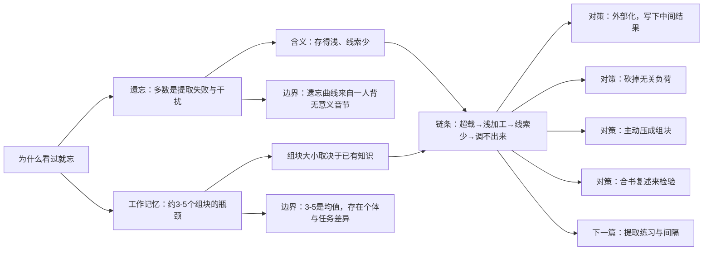

<!-- 
  封面图：将图片放在与 index.md 同目录，命名为 cover.jpg 或 cover.png
  然后在 cover.image 字段填写文件名。例如：
    cover:
      image: cover.jpg

  分类可选：日常随想 | 读书笔记 | 摄影记录 | 资源分享
-->

好久没写东西了，每天忙忙玩玩就过去了，最近的时间相对宽裕，终于有时间写点东西了。
今天刷AI给我的问题的时候，有一个问题吸引了我：学习如何学习。
说实话，“学习”应该是几乎所有的中国学生从小就开始接触的课题。当然，也包括我在内。
从2023年1月参加育才最后一次“分流考试”，最后分数距离浑南校区分数线仅差0.5分，到2026年6月的高考“压线”考上河北工业大学......可以说，除了再“哈三中”和我自己平时折腾的东西，我大多数的“学习”仅仅是停留在应付考试的程度。
那么话说回来，学习如何学习，如果只谈论停留在应付考试的程度，即使经过将近12年的“训练”，我自己想到的是三个词:理解，应用，熟练。
但是要说细节的话，我竟然想不出什么......索性下面给出AI的回答。

# 为什么看过就忘：工作记忆的容量限制怎么决定你的学法

从遗忘曲线和工作记忆约 3–5 个组块的上限，解释“读过却调不出来”的完整链条，并给出四条对应的学法。

> 工作记忆 · 遗忘曲线 · 认知负荷 · 备考方法 · 约 6 分钟 · 11 月 05 日

## 本篇要点

1. 遗忘多数时候是提取失败和干扰，而不是信息彻底消失；所以问题常出在“存得浅、线索少”，而不只是“记性差”。
2. Ebbinghaus 的遗忘曲线测的是一个人背无意义音节时的“节省”，不是“还记得百分之几”；能迁移的是先快后慢的形状，不是具体百分比。
3. 工作记忆是意识现场，在阻止复述和分组的条件下，成人同时只能保持约 3 到 5 个组块，而非“7±2”；不主动复述，十几二十秒就散。
4. 组块是能当成一个整体来用的单元，大小取决于长时记忆里已有什么，所以专家和新手的差别在于结构，而不在容量。
5. 读难度大的材料时，前提、上段结论、当前句、与已知概念的对应同时占位，很容易顶到上限，结果只能把句子读顺，放弃挂钩。
6. 超载导致浅加工，浅加工导致进入长时记忆的内容少、线索少，第二天提取失败，于是被误判为“记性不好”——这是一个闭环。
7. 可行的对策是：把要记的东西外部化、减少和理解无关的负荷、主动把零散内容压成组块、用“合上书能不能说出来”检验。

---

几乎每个备考的人都经历过：晚上合上教材，觉得这一章已经懂了，甚至能顺着讲下来；第二天早上再翻开，标题还认得，内容却像别人写的。你会很自然地得出结论——“我记性不行”。

先别急着接受这个结论。我们把它拆成两个问题：书上的内容到底有没有进入长时记忆？如果已经进入，为什么第二天调不出来？

## 遗忘更像是找不到入口，而不是信息丢失

设想你突然想不起一位老同学的名字，正尴尬时，别人说了个姓，名字立刻全回来了。如果名字真的“没了”，这个提示不可能让它回来。东西还在，只是当时缺一条线索。

记忆研究里对遗忘有几种解释，其中证据最强的一类正是这个思路：大部分遗忘来自提取失败和干扰——材料还存着，但缺少合适的线索，或者被相似的内容压住 [4]。另一种更符合直觉的老解释是“痕迹随时间衰减”，但它很难和干扰分离开来验证，所以至今仍有争议 [4]。

这个区分对备考很有用。你抱怨“忘了”的时候，问题常常不在“存没存进去”，而在存得太浅、线索太少：学的时候只跟着书上的句子走，没有和任何你已有的东西挂钩，于是第二天没有任何东西能把它拉回来。

不过“东西还在”不等于“随时都能想起来”。时间确实有规律，而且这规律很有用。

## 遗忘的速度是先快后慢

一百多年前，Ebbinghaus 拿自己当被试，背记无意义音节，隔不同时间再学一遍，看第二次学省了多少力气 [2]。他画出的曲线下降最快的部分在最前面，之后越来越平。这条“先快后慢”的形状，后来在大量材料和实验里反复出现。

但这里有三处常被省略的细节，直接决定你能不能把它套到自己身上：

- **被试只有一个人**，是他自己，不是样本。
- **材料是无意义音节**，故意去掉意义和已有联想；他自己也提醒过，这种人为控制偏离了日常记忆的条件。
- **测的是“节省”，不是“还记得百分之几”**：看第二次比第一次少花多少时间或遍数，而不是能背出多少个 [2]。

所以“学完一天后只剩 33%”这类流传很广的数字，不能直接搬到你的教材上。真正能搬的是形状：遗忘最集中的窗口，恰好是大多数人“学完这一章，等考前再看”的那段时间。

## 工作记忆：意识现场只有三四个位置

外界信息先进入感觉记忆，图像和声音一闪而过，不到一两秒；被注意到的才进入工作记忆；只有经过加工、和已有知识连起来的，才会进入长时记忆。

工作记忆就是“你此刻正在想的东西”待的地方。它的容量小得惊人：Cowan 汇总了大量在阻止复述和分组的条件下做的实验，估计成年人同时能保持约 3 到 5 个组块，而不是流传更广的“7±2” [1]。而且不主动复述的话，十几二十秒就开始散。

关键在于“组块”这个单位。它的大小取决于你能把它当成一个整体来用，不按字数算。在熟练读者眼里，英文单词 characteristics 是一个单元；对刚开始学英语的人，它是一串需要逐个辨认的字母 [3]。同样一段内容，专家的长时记忆里存着大块的现成结构，占用的位置少；新手没有这些结构，只能一个字母一个字母地扛。

心算 $27\times34$ 时你就能感到这个瓶颈：你得一边算个位、一边把中间结果存住，中途有人问你一句话，前面算的就没了。

## 把两个机制接起来，就是“看过就忘”的完整链条

读一段有难度的教材时，你其实要同时握着好几样东西：这段的前提、上一段的结论、这句话在说什么、它和你已知的哪个概念对应。这已经是四五个单元，正好顶到上限。

一旦超出，大脑通常只做一件事：把当前这句“读顺”，放弃挂钩。读顺是工作记忆里的即时效果，一合书就没。于是链条成立了：

超载 → 只能浅层加工 → 进长时记忆的内容少、线索少 → 第二天调不出来 → 你把它记成“记忆不好”。

所以“看过就忘”和“读得慢、读了后面忘前面”，往往是同一个瓶颈的两个症状，而不是两种毛病。

## 四种针对这个瓶颈的操作

**一、把工作记忆腾出来。** 读一章前，先在纸上写下你要回答的两三个问题；推导时把中间结果写下来，不要在脑子里扛。纸的容量无限，脑子不是。

**二、砍掉与理解无关的负荷。** 一次只开一份材料，关掉会跳通知的东西，别在“笔记好不好看”上耗力气。这类负担和学懂无关，却和真正的内容抢同一份容量 [3]。

**三、主动造组块。** 每学完一小节，用自己的话压成一句：“这类题先判断什么，再套什么。”压缩的过程就是把零散条目变成一个大单元，下次它只占一个位置。而压缩必须靠已有的知识做挂钩——先补基础再攻难点不是勤奋，是省容量。

**四、用“合上书能不能说出来”当检验标准。** 读着顺，只说明内容此刻在你工作记忆里，是暂时的。至于怎么安排回忆、隔多久回忆一次，是下一篇的主题。

## 这套解释的边界

3 到 5 是平均值，个体差异不小，材料、呈现时间不同，测出来的数也会变；“4 还是 7”的争论在文献里并没有完全结束 [1]。组块要靠已有知识才能形成，所以新手读得慢不是能力问题。遗忘曲线的具体百分比来自一个人背无意义音节，别把它当成你的命运。

## 思维导图

## 术语表

- 工作记忆：你此刻正在想的东西待的地方，容量只有三四个组块，是学习和思考的瓶颈。
- 组块：能被当成一个整体来处理的单元，大小取决于你已有的知识，不是字数或信息量。
- 外在认知负荷：与理解内容无关、却同样占用工作记忆的负担，比如花哨的排版、切换材料、走神的念头。
- 提取失败：材料还在长时记忆里，但缺少线索或用不上，导致想不起来；这是日常遗忘的主要解释之一。
- 节省（savings）：Ebbinghaus 测记忆的方法——第二次学习比第一次少花的时间或遍数，而不是能背出多少。

## 来源

1. [Cowan, The Magical Mystery Four — 工作记忆容量约 3–5 个组块及观测条件](https://pmc.ncbi.nlm.nih.gov/articles/PMC2864034/)
2. [Why Ebbinghaus' savings method from 1885 is a very 'pure' measure of memory performance — 说明节省法测的是什么](https://pmc.ncbi.nlm.nih.gov/articles/PMC9971077/)
3. [Sweller 等, Cognitive Architecture and Instructional Design: 20 Years Later — 组块与内在／外在认知负荷](https://link.springer.com/article/10.1007/s10648-019-09465-5)
4. [Wixted, The Psychology and Neuroscience of Forgetting — 干扰、巩固与提取失败](https://cenl.ucsd.edu/Jclub/Wixted_2004.pdf)
5. [Time to forget Ebbinghaus' forgetting curve? — 遗忘曲线被误用的评述与曲线图](https://peerreviewededucationblog.com/2022/02/11/time-to-forget-the-forgetting-curve/)

---

